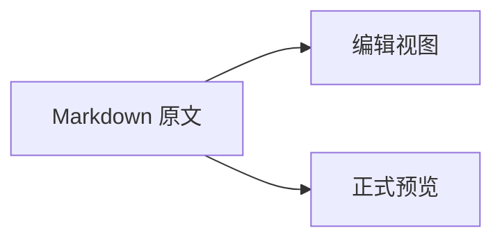

# n0v0rland-md

一个基于 **Markdown-it + Vue 3** 的可视化 Markdown 编辑器。你可以在渲染后的标题、段落和表格里直接输入，也可以随时切到源码查看真实的 Markdown。应用保存的始终是 Markdown 字符串。

## 先在这篇文档里试一试

1. 把光标移到 **这段粗体** 的开头或末尾，观察成对的星号如何出现。删掉末尾两个星号，就能取消这段文字的粗体。
2. 在页头的「语法显示」中切换「始终显示节点」「隐藏失焦节点」或「仅保留结构」，比较同一段文字。再切到「源码」核对原文，或切到「预览」查看正式排版。
3. 想试回原来的内容，可以点击「载入配置示例」。这会替换当前文档。

### 文字格式与链接

**粗体**、*斜体*、***粗斜体***、~~删除线~~、++下划线++、==高亮==、`行内代码`，以及 **粗体中的 *斜体***。

用反斜杠保留标记字面值，例如 \*这段文字不会变成斜体\*。默认预设也支持表情 :sparkles: :heart: :rocket:。链接示例见 [Markdown-it 项目](https://github.com/markdown-it/markdown-it)。

### 引用、列表和任务

> 可以在这段引用末尾按回车，下一行会自动补上引用前缀。
>
> 引用里也能使用 **强调**、*斜体*和 `行内代码`。

- 第一层项目
  - 第二层项目
  - 在这里按回车可继续当前层级

1. 编辑文字
2. 检查源码
3. 切换预览

- [x] 尝试了行内格式
- [ ] 在这里按回车，添加一项未完成的任务

---

### 表格

把鼠标移到表头顶部可调整列对齐、增删列，移到右侧边缘可增删行。单元格里的文字可以直接编辑。

| 左对齐 | 居中 | 右对齐 |
| :--- | :---: | ---: |
| 修改这一格 | 观察对齐 | 12 |
| 再加一行 | 试试工具栏 | 128 |

### 图片与脚注

点击图片下方的说明即可编辑。切到源码可以检查说明、地址和标题。


点击脚注编号可以跳到定义，也可以直接编辑定义正文[^source]。

[^source]: 编辑器通过源码范围定位光标；修改这一句后，可以切换源码查看脚注定义。

### 代码块和 Mermaid

普通代码块可在带行号的区域直接编辑。下面的流程图可以单独点击「预览图表」，再用「编辑源码」切回当前代码块。



### 默认预设与演示配置

默认预设支持上面的下划线、高亮、表情、任务列表和脚注。Mermaid 图形由演示页传入的 `renderMermaid` 回调生成。当前演示页还额外注入了三种表达语法，可以试着编辑 ::loud[**大声喧哗**]、::whisper[小声哔哔] 和 ::inner[内心独白]。

想试 Alert 提示块或站点样式，可在页头选择「主站配置」，再点击「载入配置示例」。该配置使用主站的 Markdown-it 规则和主题。

## 安装与引用

在独立项目仓库中运行 `pnpm install` 和 `pnpm run dev` 可以启动这份演示。包发布到 npm 后，可在已有 Vue 3 应用中按下面的方式安装本演示使用的基础预设和经典主题。

```bash
pnpm add @n0v0rland-md/vue @n0v0rland-md/markdown-it-adapter @n0v0rland-md/preset @n0v0rland-md/theme markdown-it
```

### 最小 Vue 示例

```vue
<script setup lang="ts">
import { ref } from 'vue'
import { createMarkdownItAdapter } from '@n0v0rland-md/markdown-it-adapter'
import { createMarkdownItPreset } from '@n0v0rland-md/preset'
import { MarkdownEditor } from '@n0v0rland-md/vue'
import '@n0v0rland-md/vue/style.css'
import '@n0v0rland-md/theme'
import '@n0v0rland-md/theme/classic.css'

const value = ref('# 我的文章\n\n可以直接编辑 **Markdown**。')
const markdown = createMarkdownItPreset()
const adapter = createMarkdownItAdapter({ markdown, profile: 'article' })
</script>

<template>
  <div class="mde-theme mde-classic">
    <MarkdownEditor v-model="value" :adapter="adapter" />
  </div>
</template>
```

已有站点可以直接传入自己的 Markdown-it 实例。语义样式也可以替换为宿主自己的样式，例如主站的 `BDmarkdown.css`。

### 包与构建产物

| 目录 | 内容 |
| --- | --- |
| `packages/core/dist` | 源文档、源码与光标映射、表格操作及语法配置协议 |
| `packages/markdown-it-adapter/dist` | Markdown-it 适配器和行内语法插件 |
| `packages/preset/dist` | 默认预设及文章、评论配置 |
| `packages/vue/dist` | Vue 组件、类型声明、合并样式及分层 CSS |
| `packages/theme/src` | Markdown 语义样式、经典主题和图标样式 |
| `examples/vue-vite/dist` | 演示页静态产物，可部署到 GitHub Pages |

## 常用组件 API

| 接口 | 用法 |
| --- | --- |
| `MarkdownEditor` | 带工具栏的完整组件。支持 `uploadImages`、`maxLength` 和 `validity`，可通过 `setMode()` 切换模式。 |
| `MarkdownInput` | 独立输入区，接收外部传入的 `mode`。可与 `MarkdownToolbar` 分开摆放。 |
| `v-model` 与 `sync()` | 绑定 Markdown 字符串。提交前可调用 `sync()` 读取当前内容。 |
| `focus()` 与 `insertTable()` | 聚焦输入区，或按指定的行数和列数插入表格。 |
| `insertSyntax()` | `MarkdownEditor` 接收工具名称，例如 `insertSyntax('bold')`。`MarkdownInput` 接收前后标记，例如 `insertSyntax('**', '**')`。 |
| `focus`、`blur`、`state-change` | 参数类型为 `MarkdownInputState`，包含焦点、内容、字符数和超限状态，可用于浮动标签或字数提示。 |
| `syntax-state-change` | 参数类型为 `MarkdownSyntaxState[]`，包含源码区间、`parentId`、`depth`、`selection`、光标、悬停和边界状态。 |

`editingStyle` 可选 `always`、`blur-hidden` 或 `structure`。`editingEffects` 可选 `theme`、`stable` 或 `none`。`syntaxEditing` 可按语法名称覆盖单项行为。

## 注入自定义语法

下面的 `::aside[内容]` 是供宿主复制的配置示例。`inlineSyntaxPlugin` 在同一个 Markdown-it 实例中注册解析规则和默认渲染规则，适配器用同一份定义映射源码。

```ts
import MarkdownIt from 'markdown-it'
import { MARKDOWN_SYNTAX_VERSION, type MarkdownSyntaxDefinition } from '@n0v0rland-md/core'
import {
  bracketSyntaxParts,
  inlineSyntaxPlugin,
  createMarkdownItAdapter,
} from '@n0v0rland-md/markdown-it-adapter'

const definitions: MarkdownSyntaxDefinition[] = [{
  name: 'aside',
  scope: 'inline',
  className: 'my-markdown-aside',
  contentMode: 'markdown',
  getInlineParts: bracketSyntaxParts,
  editing: { reveal: 'near', effect: 'pause-inside' },
  toolbar: { label: '旁白', before: '::aside[', after: ']', profiles: ['article'] },
}]

const markdown = new MarkdownIt({ html: false }).use(inlineSyntaxPlugin, definitions)
const adapter = createMarkdownItAdapter({
  markdown,
  syntax: { version: MARKDOWN_SYNTAX_VERSION, definitions },
})
```

在应用中直接引用 `@n0v0rland-md/core` 时，也需要把它加入应用的依赖。将上面的 `adapter` 传给组件，再给 `className` 配置 CSS，就可以输入 `::aside[**重点内容**]`。`contentMode: 'markdown'` 允许正文包含嵌套格式，`text` 则保留正文的字面值。

```css
.my-markdown-aside {
  padding-inline: .35em;
  border-inline-start: .2rem solid #73a884;
  background: color-mix(in srgb, #73a884 16%, transparent);
}
```

第三方插件可在 `token.meta` 中提供 `syntaxKind`、`sourceFrom` 和 `sourceTo`，或在定义中提供 `getSourceRange`。自定义块还需要 `getBlockParts` 标明可编辑正文。范围缺失或无法验证时，编辑器保留源码供修改，正式预览仍使用宿主的 Markdown-it renderer。

## 主题、布局与开发

整包样式可以通过 `@n0v0rland-md/vue/style.css` 引入，也可以分别加载 `editor.css`、`toolbar.css`、`visual.css` 和 `table.css`。默认经典主题、Markdown 语义样式与宿主覆盖分别加载。可以用 `--mde-font-family` 调整经典主题字体，用 `--mde-syntax-color` 调整语法标记颜色，用 `--mde-toolbar-gap` 调整工具栏间距。

文章页可把 `MarkdownToolbar` 放在 `MarkdownInput` 上方，评论区可放在下方。两者可以按各自的页面需求选择 Markdown-it 配置。更多细节见仓库的 [语法配置协议](https://github.com/TMyxGames/n0v0rland-md/blob/main/docs/syntax-definition.md) 和 [发布与主题说明](https://github.com/TMyxGames/n0v0rland-md/blob/main/docs/release.md)。

```bash
pnpm run build
pnpm run verify
pnpm run verify:packages
pnpm run verify:integration-browser
```
